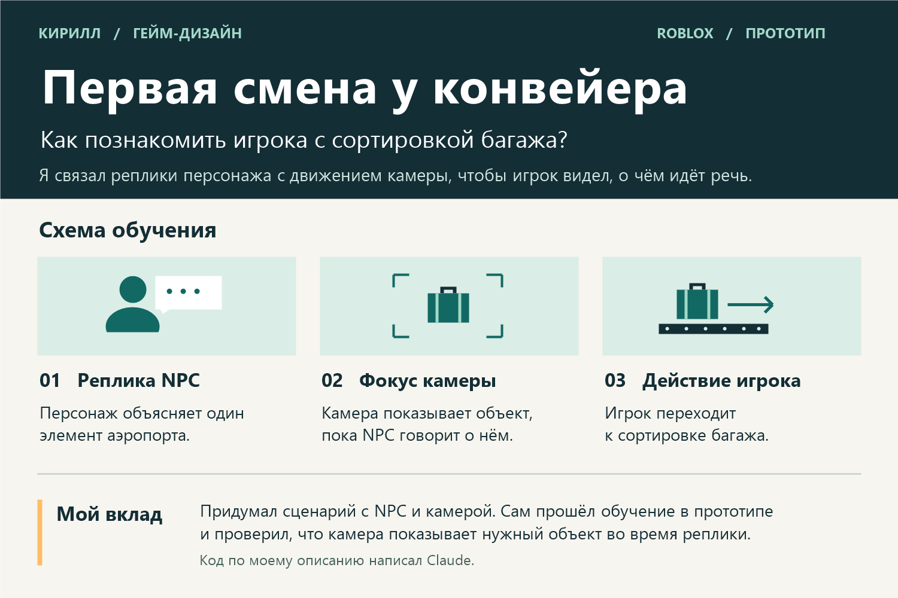

# Аэропорт в Roblox

Игровой прототип на Luau. Игрок распределяет чемоданы с конвейера по нужным направлениям и улучшает свой аэропорт.

Я описал механику сортировки, пробовал разные варианты скорости ленты и планировки. Для обучения предложил диалог с NPC, во время которого камера показывает объект из реплики. Схема ниже иллюстрирует проверенную мной итерацию. Код проекта писал Claude по моим описаниям.

## Как открыть

Скачайте AirportPrototype.rbxlx и откройте в Roblox Studio. Для сборки из исходников используйте Rojo из корня репозитория:

~~~sh
rojo build default.project.json -o AirportPrototype.rbxlx
~~~

В src/client находится интерфейс, в src/server — игровая логика, в src/shared — правила и настройки. Разработка на паузе.
